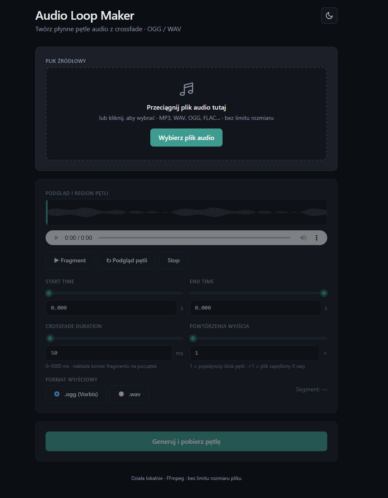

# Audio Loop Maker



Lokalna aplikacja webowa do tworzenia **płynnych pętli audio** (seamless loop) z crossfade. Wspiera długie nagrania (5 minut i dłuższe) oraz eksport do **.ogg (Vorbis)** i **.wav**.

Działa na **Windows 11** i **Linux** (wymaga Node.js ≥ 18). FFmpeg jest dołączony przez `ffmpeg-static` — nie trzeba instalować go osobno.

## Wymagania

- [Node.js](https://nodejs.org/) 18 lub nowszy
- npm (dołączony do Node.js)

## Instalacja

W katalogu projektu:

```bash
npm install
```

## Uruchomienie

```bash
node server.js
```

albo:

```bash
npm start
```

Otwórz w przeglądarce: [http://localhost:3000](http://localhost:3000)

## Jak korzystać

1. **Wybierz plik audio** (przeciągnij i upuść lub kliknij) — MP3, WAV, OGG, FLAC i inne.
2. Ustaw **Start Time** i **End Time** suwakami lub polami tekstowymi.
3. Dobierz **Crossfade Duration** (0–5000 ms), aby uniknąć trzasków na styku pętli.
4. Wybierz **format wyjściowy** (.ogg / .wav) oraz opcjonalnie liczbę **powtórzeń**.
5. Odsłuchaj fragment lub włącz **Podgląd pętli** w przeglądarce.
6. Kliknij **Generuj i pobierz pętlę** — po zakończeniu plik zapisze się na dysk.

## Struktura projektu

```
my-loop-maker/
├── server.js          # Backend Express + FFmpeg
├── package.json
├── README.md
├── public/
│   ├── index.html     # Interfejs (HTML + Tailwind CSS)
│   └── outputs/       # Wygenerowane pętle (tymczasowe)
└── uploads/           # Wgrane pliki źródłowe (tymczasowe)
```

## API (skrót)

| Metoda | Ścieżka | Opis |
|--------|---------|------|
| `POST` | `/api/upload` | Upload pliku audio (`multipart`, pole `audio`) |
| `POST` | `/api/generate` | Generowanie pętli (JSON: `filename`, `start`, `end`, `crossfadeMs`, `format`, `repeats`) |
| `GET`  | `/uploads/...` | Podgląd wgranego pliku |
| `GET`  | `/outputs/...` | Pobranie wygenerowanej pętli |

Upload używa **zapisu na dysk** (multer `diskStorage`) — bez limitu rozmiaru w pamięci RAM.

## Licencja

MIT
